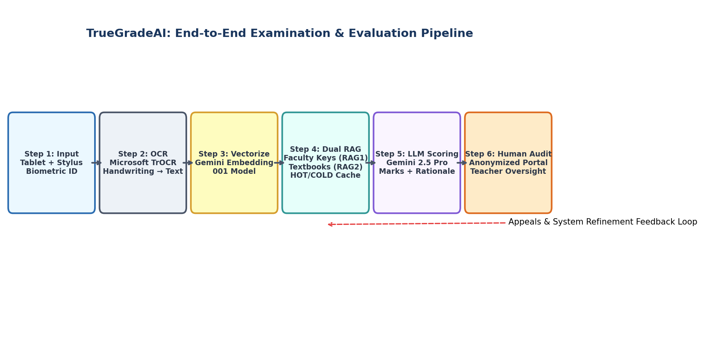

# Reading Notes & Report: Understanding TrueGradeAI

**Paper Title:** TrueGradeAI: Retrieval-Augmented and Bias-Resistant AI for Transparent and Explainable Digital Assessments  
**Authors:** Rakesh Thakur, Shivaansh Kaushik, Gauri Chopra, and Harsh Rohilla (Amity University)  
**Publication Status:** arXiv Preprint (`arXiv:2509.22516` [cs.AI]), Submitted to ICLR 2026  
**Document Context:** Personal Reading Summary & Critical Analysis  

---

## 1. Executive Summary & Personal Takeaways

Reading through **TrueGradeAI**, my biggest takeaway is that it bridges a major gap in digital education: **how to eliminate paper waste and grading bias without forcing students to give up natural handwriting.** 

Most previous digital exam tools either replace handwriting with typing (which doesn't work well for equations, diagrams, or open-ended essays) or simply store digitized PDFs for manual grading without helping teachers. TrueGradeAI builds a full end-to-end pipeline: students write with a stylus on locked tablets, AI transcribes their strokes using vision transformers, a **Dual Retrieval-Augmented Generation (RAG)** engine cross-checks answers against verified faculty keys and textbooks, and an LLM provides a score along with a **fact-linked explanation**.

Below is my structured breakdown of the workflow, architecture, empirical findings, practical uses, and limitations.

---

## 2. Why Paper Assessments Are Broken

The paper opens by framing three major flaws of traditional paper-based exams:

1. **Environmental Damage & Waste:** Studies show that over **30% of printed pages in university answer booklets go completely unused**. Millions of pages are printed, shipped, and dumped every exam session.
2. **Logistical Headaches:** Printing, physically securing, transporting, and storing thousands of physical booklets creates massive administrative cost and risk.
3. **Slow & Biased Evaluation:** Manual grading takes weeks. Worse, human evaluators introduce subjective bias based on handwriting neatness, candidate identity, gender, or socioeconomic background.

---

## 3. End-to-End Workflow (Sequential Step-by-Step)

The paper's architecture processes an exam from student login to final teacher audit in six sequential steps:

### Step 1: Secure Authentication & Stylus Capture
* **Biometric Verification:** Before the exam starts, students pass facial recognition and admit card OCR checks on institution-provided tablets.
* **Locked Tablet Environment:** The tablet locks out external browsing or apps. Students use a stylus on a digital canvas, preserving their natural writing experience.

### Step 2: Transformer-based OCR Transcription
* **Microsoft TrOCR:** Raw stylus pen strokes and page images are transcribed into machine-readable text using Microsoft's Vision Transformer OCR (**TrOCR**). 
* **Data Security:** Both raw pen strokes and digital text are encrypted and stored in the exam database for full auditability.

### Step 3: Vector Embedding Conversion
* **`gemini-embedding-001` Model:** Transcribed student text is encoded into dense vector embeddings using Google's `gemini-embedding-001` model to capture deep semantic meaning rather than relying on exact keyword matching.

### Step 4: Dual RAG & Two-Tier Caching Engine
To keep evaluation anchored in true facts rather than LLM "hallucinations", TrueGradeAI uses two knowledge sources and two memory tiers:
* **RAG1 (Faculty Knowledge Base):** Official answer keys prepared by faculty, chunked question by question.
* **RAG2 (Supporting Materials):** Supplementary textbooks (e.g., NCERT) chunked by topic.
* **HOT / COLD Memory Policy:** Top relevant facts start in **COLD storage**. Frequently retrieved facts get promoted to **HOT memory** for high-speed access.
* **Fallback Mechanism:** If a student's answer scores low against RAG1 (e.g., below a 20% similarity threshold), the system queries RAG2 for relevant conceptual facts, updating the COLD cache for future questions.

### Step 5: LLM Scoring & Fact-Linked Rationales
* **Gemini 2.5 Pro Evaluator:** The LLM receives the student's answer, faculty answer keys (RAG1), and retrieved textbook context (RAG2/Caches).
* **Output Generation:** The model produces:
  1. A **numerical score** aligned with the marking scheme.
  2. A **structured rationale** detailing what key points the student included, what they missed, and how to improve.
  3. An **evidence-linked audit log** citing exact source facts.

### Step 6: Anonymized Teacher Portal & Human Audit
* **Randomized Script Allocation:** Submissions are anonymized and randomly distributed to reviewers to eliminate identity-based bias.
* **Human-in-the-Loop Oversight:** If the AI expresses low confidence or if a student files an appeal, human teachers can review, override scores, and leave feedback in the audit trail.

---

## 4. Key Findings & Empirical Performance

The authors evaluated TrueGradeAI on a benchmark dataset of **10,000 question-answer pairs** from NCERT Class 12 History, Political Science, and Geography textbooks:

* **Agreement with Human Evaluators:**
  * **Pearson Correlation ($r$):** `0.982` (Extremely high linear correlation with human marks).
  * **Spearman Rank Correlation ($\rho$):** `0.985` (Strong rank order consistency).
  * **Cohen's Kappa ($\kappa$):** `0.688` (Substantial categorical agreement).
* **The Necessity of RAG:** The authors tested grading stability over 100 questions:
  * **LLM Only:** Correlation degrades quickly as question volume increases due to context drift and lack of grounding.
  * **LLM + RAG1:** Significantly improves accuracy and stability.
  * **LLM + RAG1 + RAG2:** Delivers the highest, most consistent correlation across all evaluations.
* **Speed:** Grading turnaround drops from **weeks to hours**.

---

## 5. Practical Uses & Real-World Applications

1. **University & School Board Examinations:** Replaces physical paper booklets in large-scale exams while maintaining natural handwriting for essay-type answers.
2. **Standardized Competitive Testing:** Enables scalable, objective grading for national tests with built-in audit trails for appeals.
3. **Institutional Knowledge Retention:** Converts faculty answer keys and textbook facts into a growing, searchable institutional repository.

---

## 6. Critical Thinking: Limitations & Challenges

While TrueGradeAI is a major leap forward, my reading highlights a few practical limitations:

* **High Initial Hardware Cost:** Supplying locked tablets, high-precision styluses, and secure local/cloud server infrastructure requires substantial upfront capital.
* **OCR Edge Cases:** Very messy handwriting, non-standard symbols, mathematical notation, or complex diagrams can still trick TrOCR, requiring human intervention.
* **Faculty Upfront Workload:** Setting up high-quality RAG1 answer keys requires meticulous preparation from teachers before the exam starts.
* **Cloud & GPU Reliance:** Running TrOCR, embedding models, and Gemini 2.5 Pro requires reliable internet bandwidth and powerful GPUs .

---

## 7. Future Scope & Extensions

The authors outline several promising future directions that make this paper stand out:

* **Turning Exam Caches into Student Study Guides:** Reusing frequently accessed RAG facts to generate personalized study materials for students after the exam.
* **Automated Diagnostic Weakness Tracking:** Analyzing student mistakes across topics to flag class-wide learning gaps for teachers.
* **Multimodal Stroke Dynamics:** Incorporating pen stroke pressure, speed, and temporal cues into TrOCR to boost recognition accuracy on difficult handwriting styles.

---

